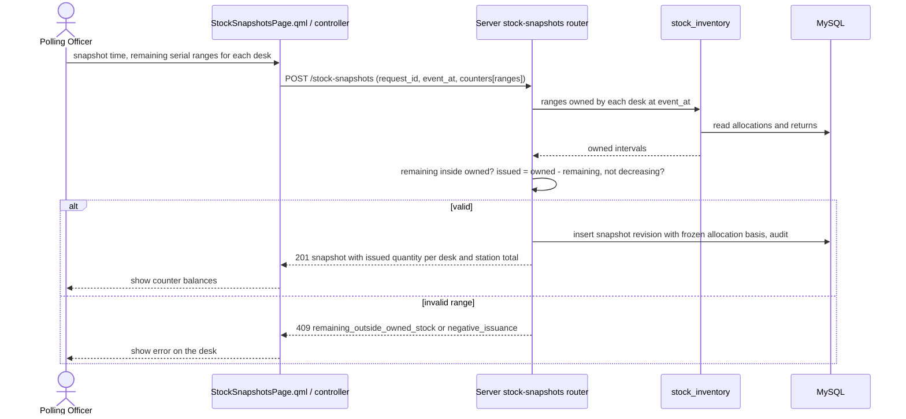
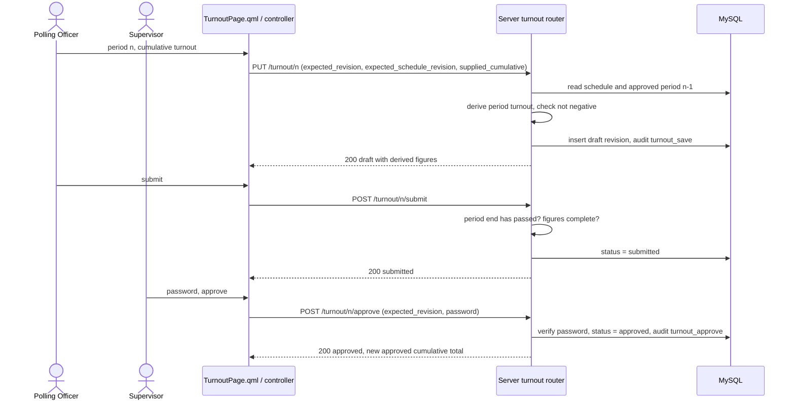

# 04. Ballot issue snapshots (P(12)) and hourly turnout (P(15))

| Item | Value |
| --- | --- |
| Person in charge | Toby |
| Reference manual | 6.3 P(12 Snapshot) and 6.4 P(15) Hourly voter turnout (pp. 54–59) |
| Server code | `src/election/server/stock_snapshots.py`, `stock_snapshot_reports.py`, `turnout.py`, `turnout_basis.py`, `reporting_periods.py`, `turnout_reports.py` |
| Desktop code | `src/election/desktop/stock_snapshots.py`, `turnout.py`, `qml/StockSnapshotsPage.qml`, `qml/TurnoutPage.qml` |
| API | `/api/workspace/stations/{station_id}/stock-snapshots` (`GET`, `POST`, `PUT /{id}`, history, statement); `/turnout` (`GET`, `PUT /{period}`, `POST /{period}/submit`, `/approve`, `/amend`, history, statement) |
| Former automated tests | `tests/test_stock_snapshot_api.py` and six related files, `tests/test_turnout_api.py`, `tests/test_turnout_desktop.py`, `tests/test_qml_turnout.py`, `tests/test_turnout_reports.py` (commit `c68fb54`) |

## 1. User requirements

- UR-04.1 At a snapshot time the polling officer enters, for each issuing desk, the serial
  numbers of the ballot papers still at the desk. The system works out how many ordinary
  papers have been issued.
- UR-04.2 For each reporting period the officer records the voter turnout, either as the
  figure for the period or as the running total.
- UR-04.3 The Supervisor approves each period before it is treated as official.
- UR-04.4 If an earlier figure is corrected, later figures that depend on it must be looked at
  again.
- UR-04.5 The P(12) and P(15) statements can be printed for display and filing.

## 2. Functional requirements

Snapshots (P(12)):

| ID | Requirement | Role | Implemented in |
| --- | --- | --- | --- |
| FR-SNP-01 | The system shall record a snapshot with an observation time and, for each issuing desk, the serial ranges of papers remaining at the desk. | Polling Officer | `POST /stock-snapshots` (`StockSnapshotInput`) |
| FR-SNP-02 | The system shall calculate the ordinary papers issued by each desk and by the station as papers owned by the desk at the snapshot time minus papers remaining. | Polling Officer | `stock_snapshots.py` |
| FR-SNP-03 | The system shall reject a remaining range that the desk does not own, and any snapshot that would make issued papers negative or lower than in an earlier snapshot. | Polling Officer | 409 `remaining_outside_owned_stock`, `negative_issuance` |
| FR-SNP-04 | The system shall distinguish a desk that was not reported from a desk reported with zero papers remaining. | Polling Officer | `stock_snapshots.py` |
| FR-SNP-05 | The system shall reject a snapshot time in the future. | Polling Officer | 422 `event_time_in_future` |
| FR-SNP-06 | The system shall allow a snapshot to be corrected only with a reason, keeping the earlier revision. | Polling Officer | `PUT /stock-snapshots/{id}` |
| FR-SNP-07 | The system shall mark a snapshot as needing review when an allocation it depends on is changed afterwards. | Polling Officer | snapshot basis check |

Turnout (P(15)):

| ID | Requirement | Role | Implemented in |
| --- | --- | --- | --- |
| FR-TUR-01 | The system shall divide polling hours into reporting periods from the planned opening time using the reporting interval in the election schedule. | Administrator (schedule) | `reporting_periods.py`, `ScheduleInput.reporting_interval_minutes` |
| FR-TUR-02 | The system shall accept, for a period, the turnout of the period, the cumulative turnout, or both, and shall derive the missing figure from the previous approved period. | Polling Officer | `PUT /turnout/{period}` (`supplied_hourly`, `supplied_cumulative`) |
| FR-TUR-03 | The system shall reject figures that are inconsistent: a cumulative total lower than the previous period, or period and cumulative figures that do not agree. | Polling Officer | 422 `turnout_validation` |
| FR-TUR-04 | The system shall treat a missing period and a period reported as zero as different states. | Polling Officer | `turnout.py` |
| FR-TUR-05 | The system shall allow a period to be submitted only after the period has ended, and only with the time the figure was read (not before the period end) and a note of its source. | Polling Officer | `POST /turnout/{period}/submit`; `validate_content` |
| FR-TUR-06 | The system shall let only a Supervisor approve a submitted period, after re-entering the Supervisor's own password. | Supervisor | `POST /turnout/{period}/approve` |
| FR-TUR-07 | The system shall allow an amendment of a submitted or approved period only with a reason, and shall then require every later approved period to be reviewed again. | Polling Officer, Supervisor | `POST /turnout/{period}/amend`; 409 `turnout_review_required` |
| FR-TUR-08 | The system shall show the cumulative turnout over the continuous run of approved periods from the opening. | All operational roles | `GET /turnout` |
| FR-TUR-09 | The system shall record how each figure was obtained: copied from the external register (normal), calculated from ordinary stock issued (fallback), or reconciled after recovery. | Polling Officer | `mode` = `normal` / `fallback` / `recovery`; see document 06 |
| FR-TUR-10 | The system shall export the station turnout statement and a single-period statement as CSV and PDF. | All operational roles | `turnout_reports.py` |

Non-functional requirements that apply: NFR-DATA-01, NFR-REL-01, NFR-REL-02, NFR-USA-01, NFR-USA-02.

## 3. Use case UC-04: Report and approve the turnout of a period

| Field | Description |
| --- | --- |
| Actors | Polling Officer (primary); Supervisor (approver); electronic poll register (external source of the figure) |
| Description | After a reporting period ends, the officer reads the turnout from the register, records it, and the Supervisor approves it. |
| Data | Period number, turnout of the period and/or cumulative turnout, source note, Supervisor password |
| Stimulus | The reporting period ends |
| Response | The period shows "Approved"; the station's approved cumulative turnout is updated |
| Pre-condition | The election is active; the schedule defines the reporting interval; the previous period is approved (or this is the first period) |
| Post-condition | An approved turnout revision exists; a P(15) statement can be exported |
| Comments | In EPR fallback mode the figure is calculated from a P(12) snapshot instead (document 06) |

Main flow:

1. The officer opens "Period turnout" and selects the period that has just ended.
2. The officer enters the cumulative turnout shown by the register, the time it was read and
   a note of the source.
3. The system derives the turnout of the period from the previous approved total.
4. The officer presses "Save turnout draft" and then "Submit this revision for Supervisor
   approval".
5. The Supervisor reviews the figures, enters their password and presses "Approve this
   turnout revision".
6. The system updates the approved cumulative turnout.

Alternative flows:

- 2a. The officer enters the period figure instead: the system derives the cumulative total.
- 3a. The cumulative total is lower than the previous period: the system rejects the draft.
- 4a. The period has not ended: the draft can be saved, but submission is refused.
- 5a. The Supervisor password is wrong: approval is refused.
- 6a. A figure is found to be wrong later: the officer amends it with a reason; later approved
  periods show "review required" until each is submitted and approved again.

## 4. Sequence diagrams

Snapshot (P(12)):

Turnout (P(15)):

## 5. Design notes

- A snapshot stores the allocation revisions it was calculated from (its basis). If an
  allocation is changed later, the snapshot is not recalculated silently; it is flagged.
- Turnout periods are identified by index from the opening time; the table is not pre-filled,
  so a long schedule does not create empty rows.
- Quantities are limited to signed 64-bit integers (`MAX_TOTAL`).
- Demo data: one snapshot with 50 papers remaining at each desk (300 ordinary papers
  issued); one approved turnout period with 300 electors.

## 6. Test cases

System tests (manual, on a rehearsal copy of the paper-ballot demo server, stage `polling`; TC-SNP-04 and
TC-TUR-02 change seeded figures, so do not run them on the copy used for the video):

| ID | Requirement | Pre-condition | Steps | Expected result | Result |
| --- | --- | --- | --- | --- | --- |
| TC-SNP-01 | FR-SNP-01, FR-SNP-02 | Signed in as `demo_polling` | Open "Counter balances" and view the seeded snapshot. | Each desk: 200 allocated, 50 remaining, 150 issued; station issued 300 | Not run |
| TC-SNP-02 | FR-SNP-03 | Same | Record a new snapshot giving Counter 1 a remaining range that belongs to Counter 2. | Rejected; no snapshot saved | Not run |
| TC-SNP-03 | FR-SNP-03 | Same | Record a new snapshot at a later time in which Counter 1 has more papers remaining than in the seeded snapshot. | Rejected: issued papers cannot go down | Not run |
| TC-SNP-04 | FR-SNP-06 | Same | Correct the seeded snapshot without a reason, then with a reason. | Without reason: rejected. With reason: revision 2 saved; revision 1 in history | Not run |
| TC-TUR-01 | FR-TUR-08 | Signed in as `demo_polling` | Open "Period turnout". | Period 1 is "Approved" with turnout 300; approved cumulative turnout 300 | Not run |
| TC-TUR-02 | FR-TUR-07 | Same | Amend period 1 to 299 without a reason, then with a reason; submit. | Without reason: rejected. With reason: new draft, then "Submitted for review"; revision history shows 300 and 299 | Not run |
| TC-TUR-03 | FR-TUR-06 | TC-TUR-02 done; signed in as `demo_supervisor` | Approve with a wrong password, then with the correct password. | First refused; second "Approved" | Not run |
| TC-TUR-04 | FR-TUR-06, NFR-SEC-04 | Signed in as `demo_polling` | Try to approve a submitted period. | No approval is possible for a Polling Officer | Not run |
| TC-TUR-05 | FR-TUR-10 | Same | Export the period statement as CSV and PDF in two languages. | Files contain the approved figure, revision and approver | Not run |

Execution status (26 Nov 2026, Toby): TC-SNP-01 to 04 and TC-TUR-01 to 05 were **not run**. The
shared v1.1.0 demo server runs the e-polling election, in which the snapshot and turnout pages are
hidden, and no paper-ballot rehearsal copy was deployed. The cases stay as designed for the next
release that deploys a paper-ballot server (see document 12, section 6).

Equivalence partitions for the cumulative turnout of period n: lower than period n−1
(invalid), equal to period n−1 (valid, period turnout 0), higher (valid), not a whole number
or negative (invalid), above the 64-bit limit (invalid).

Automated tests (unit / API level, from the project history):

| Test | Requirement |
| --- | --- |
| `test_stock_snapshot_api.py::test_officer_records_remaining_stock_and_another_client_reads_its_exact_saved_basis` | FR-SNP-01, FR-SNP-02 |
| `test_stock_snapshot_api.py::test_later_new_snapshot_cannot_restore_papers_previously_observed_as_issued` | FR-SNP-03 |
| `test_stock_snapshot_api.py::test_snapshot_collection_distinguishes_missing_unreported_counter_and_explicit_zero` | FR-SNP-04 |
| `test_stock_snapshot_api.py::test_backdated_allocation_invalidates_current_snapshot_basis_until_reasoned_revision` | FR-SNP-07 |
| `test_turnout_api.py::test_hourly_cumulative_and_combined_inputs_use_adjacent_approved_endpoints_once` | FR-TUR-02 |
| `test_turnout_api.py::test_approval_rejects_negative_deltas_inconsistent_figures_and_signed64_overflow` | FR-TUR-03 |
| `test_turnout_api.py::test_configured_periods_and_explicit_zero_are_approved_while_opening_is_missing` | FR-TUR-01, FR-TUR-04 |
| `test_turnout_api.py::test_future_period_drafts_and_explicit_zero_submission_at_the_exact_period_end` | FR-TUR-05 |
| `test_turnout_api.py::test_reasoned_upstream_amendment_invalidates_later_approvals_until_each_basis_is_reviewed` | FR-TUR-07 |
| `test_turnout_api.py::test_approval_replays_reconfirm_the_current_supervisor_password_and_never_expose_it` | FR-TUR-06, NFR-SEC-02 |

## 7. Differences from the reference manual

| Manual | Election Desk | Reason |
| --- | --- | --- |
| Exactly three snapshots (by 12:30, 15:30, 18:30) | Any number of snapshots, each with its own time | Polling hours are configurable; three is a procedure, not a system limit |
| Desks entered one after another with Next / Previous | All desks on one page | A desktop screen has room for the whole station |
| P(15) is a paper form filled in from the system and faxed | Turnout is recorded per period, approved, and exported as a statement | Approval and audit trail |
| Hourly periods | Period length set in the election schedule (1 to 1,440 minutes) | Configurable |
| With the register running, the public figure comes from the register | Same: `normal` mode records a figure copied from the register; stock-based calculation is used only in fallback | Matches the manual's rule |
