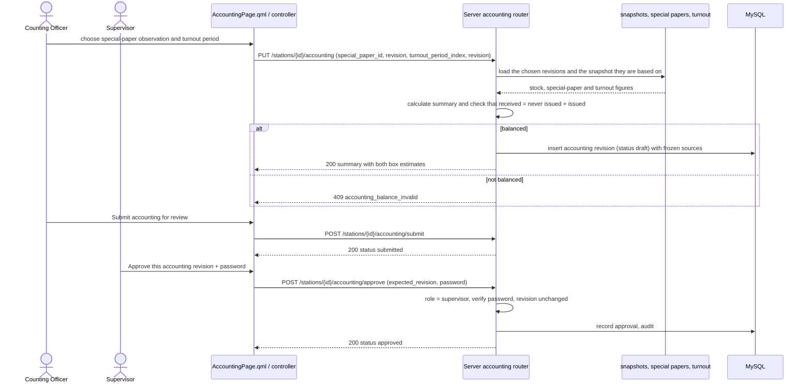
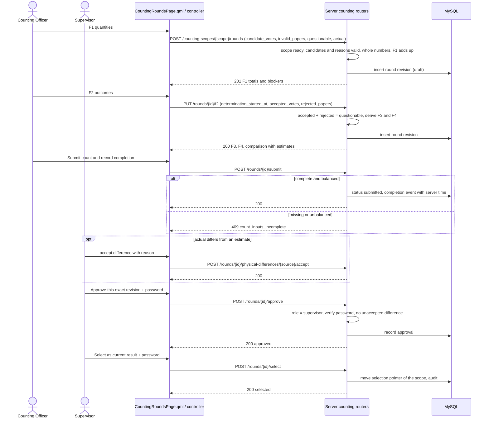

# 09. Count report: P(18) ballot paper account and forms F1 to F4

| Item | Value |
| --- | --- |
| Person in charge | Toby |
| Reference manual | 9.3 P(18); 9.4 First box opening; 10. Counting report F1 to F4 (pp. 112–132) |
| Server code | `accounting.py`, `accounting_reports.py`, `counting_scopes.py`, `counting_rounds.py`, `counting_outcomes.py`, `counting_totals.py`, `counting_workflow.py`, `counting_discrepancies.py`, `f1_reports.py`, `count_reports.py`, `invalid_ballot_reasons.py` (all under `src/election/server/`) |
| Desktop code | `qml/AccountingPage.qml`, `CountingScopesPage.qml`, `CountingRoundsPage.qml`, `CountOutcomesPanel.qml`, `InvalidReasonsPage.qml`; controllers `accounting.py`, `counting_scopes.py`, `counting_rounds.py`, `invalid_reasons.py` under `src/election/desktop/` |
| API | `/stations/{id}/accounting`, `/stations/{id}/counting-scopes`, `/stations/{id}/counting-scopes/{scope_id}/rounds` |
| Former automated tests | `test_accounting_*.py`, `test_counting_scopes_api.py`, `test_counting_rounds_api.py`, `test_counting_outcomes_api.py`, `test_counting_workflow_api.py`, `test_count_reports_api.py` (commit `c68fb54`) |

## 1. Forms and how they relate

| Form | Content | Entered or calculated |
| --- | --- | --- |
| P(18) Ballot paper account | Papers received, never issued, issued, special papers, estimated papers in the boxes | Calculated from stock (03, 04), special papers (08) and turnout (04); the officer only chooses the sources |
| F1 Initial tally | Valid votes per candidate (A), clearly invalid papers by reason (B), questionable papers (C), actual papers counted | Entered |
| F2 Determination of questionable papers | Questionable papers accepted per candidate; questionable papers rejected by reason | Entered |
| F3 Invalid paper breakdown | All invalid papers by reason (F1 clearly invalid + F2 rejected) | Calculated |
| F4 Final count | Final votes per candidate (F1 + F2 accepted), final invalid, final accounted | Calculated |

Arithmetic rules enforced by the server:

```
F1: actual_counted = sum(candidate votes) + sum(clearly invalid) + questionable
F2: sum(accepted) + sum(rejected) = questionable
F4: final votes(candidate) = F1 votes(candidate) + F2 accepted(candidate)
    final invalid          = F1 clearly invalid + F2 rejected
    final accounted        = final valid + final invalid = actual_counted
P(18): received = never issued + ordinary issued + replacement issued + tendered issued
       box estimate from stock   = ordinary issued − retrieved-unused
       box estimate from turnout = approved cumulative turnout − retrieved-unused
```

## 2. User requirements

- UR-09.1 After the poll the counting officer prepares the ballot paper account without
  typing the figures again.
- UR-09.2 The counting officer enters the count on F1 and F2; the system fills in F3 and F4.
- UR-09.3 The system warns when the figures do not add up or differ from the account.
- UR-09.4 The supervisor confirms the count with a password; the completion time is recorded
  automatically.
- UR-09.5 The forms can be previewed and exported so that the paper forms can be completed.

## 3. Functional requirements

Ballot paper account, P(18):

| ID | Requirement | Role | Implemented in |
| --- | --- | --- | --- |
| FR-ACC-01 | The system shall prepare the ballot paper account of a station from one special-paper observation revision and, optionally, one turnout period revision selected by the officer. | Counting Officer | `PUT /accounting` (`AccountingInput`) |
| FR-ACC-02 | The system shall calculate all account quantities and shall reject an account that does not balance. | Counting Officer | `accounting.py` (409 `accounting_balance_invalid`) |
| FR-ACC-03 | The system shall give two estimates of the papers in the boxes: from stock, and from turnout only when the turnout record has a valid approval. | Counting Officer | `estimated_box_from_stock_quantity`, `estimated_box_from_turnout_quantity` |
| FR-ACC-04 | The system shall reject a turnout period that ends after the special-paper observation. | Counting Officer | 409 `accounting_turnout_time_invalid` |
| FR-ACC-05 | The system shall follow the reviewed-record workflow: draft, submit, approve by a Supervisor with password; a correction after submission requires a reason and keeps the earlier revision. | Counting Officer, Supervisor | `POST /accounting/submit`, `/approve` (422 `accounting_reason_required`) |
| FR-ACC-06 | The system shall mark an account as needing review when one of its sources is changed afterwards. | — | `accounting_source_stale`; "Sources changed" |
| FR-ACC-07 | The system shall export the account as CSV and PDF. | All operational roles | `accounting_reports.py` |

Counting scope:

| ID | Requirement | Role | Implemented in |
| --- | --- | --- | --- |
| FR-CNT-01 | The system shall define a counting scope at a counting station: a reference, the received boxes to be counted together and the approved account of each origin station. | Counting Officer | `POST /counting-scopes` |
| FR-CNT-02 | The system shall not allow a box to belong to two scopes. | Counting Officer | 409 `box_already_in_scope` |
| FR-CNT-03 | The system shall allow count entry only when every box in the scope is received and every source account is approved. | Counting Officer | blockers `box_receipt_missing`, `source_accounting_missing`, `source_accounting_unapproved`; 409 `count_scope_not_ready` |

F1 to F4:

| ID | Requirement | Role | Implemented in |
| --- | --- | --- | --- |
| FR-CNT-04 | The system shall record F1 for a scope: observation time, valid votes per candidate, clearly invalid papers per reason, questionable papers and actual papers counted. | Counting Officer | `POST/PUT /rounds` (`counting_rounds.py`) |
| FR-CNT-05 | The system shall accept only whole numbers of zero or more, and shall treat a blank quantity as "not observed", not as zero. | Counting Officer | `counting_round_models.py`; blockers `f1_candidate_missing` etc. |
| FR-CNT-06 | The system shall take the invalid-paper reasons from the catalogue maintained by the Administrator (defaults: seven reasons (a) to (g) and "Other" for F1; four reasons (h) to (k) and "Other" for F2) and shall require an explanation for a positive quantity under "Other". | Administrator, Counting Officer | `invalid_ballot_reasons.py`; 422 `invalid_reason_explanation_required` |
| FR-CNT-07 | The system shall reject an F1 in which all quantities are entered but actual papers counted differ from candidate votes plus clearly invalid plus questionable papers. An F1 with blank quantities is saved as an incomplete draft. | Counting Officer | 422 `f1_arithmetic_invalid` |
| FR-CNT-08 | The system shall record F2: start time of determination, questionable papers accepted per candidate and rejected per reason. | Counting Officer | `PUT /rounds/{id}/f2` (`counting_outcomes.py`) |
| FR-CNT-09 | The system shall reject an F2 whose outcomes exceed the questionable papers of F1, and an F2 in which all outcomes are entered but accepted plus rejected papers differ from the questionable papers. | Counting Officer | 422 `f2_outcomes_exceed_questionable`, `f2_outcomes_unbalanced` |
| FR-CNT-10 | The system shall calculate F3 and F4 from F1 and F2 without further input. | — | `counting_totals.py` |
| FR-CNT-11 | The system shall compare actual papers counted with the stock estimate and the turnout estimate of the scope and show each difference. | Counting Officer, Supervisor | `counting_totals.py` (`f2_physical_comparisons`) |
| FR-CNT-12 | The system shall accept submission of a count only when all observations are present and balanced, and shall record the count completion time at submission. | Counting Officer | `POST /rounds/{id}/submit` (409 `count_inputs_incomplete`) |
| FR-CNT-13 | The system shall require a Supervisor to accept every known physical difference with a reason before approval. | Supervisor | `POST /rounds/{id}/physical-differences/{source}/accept`; 409 `count_physical_difference_unaccepted` |
| FR-CNT-14 | The system shall require the Supervisor's own password to approve one exact revision of a count. | Supervisor | `POST /rounds/{id}/approve` |
| FR-CNT-15 | The system shall require the Supervisor's own password to select an approved round as the current result of the scope; only a selected round contributes to the constituency result. | Supervisor | `POST /rounds/{id}/select` |
| FR-CNT-16 | The system shall require a reason to correct a submitted F1 or F2 and shall keep the submitted revision; a corrected revision must be submitted and approved again. | Counting Officer | `POST /rounds/{id}/amend-f1`, `/amend-f2` (422 `count_amendment_reason_required`) |
| FR-CNT-17 | The system shall preview and export F1, F2, F3, F4 and the complete count record as CSV and PDF in the selected language. | All operational roles | `f1_reports.py`, `count_reports.py` |

System-wide and non-functional requirements that apply: FR-SYS-04 (revisions), FR-SYS-05
(password re-entry on approval), NFR-DATA-01, NFR-SEC-04, NFR-REL-01, NFR-REL-02, NFR-USA-02.

## 4. Use case UC-09: Count the ballot papers of a scope

| Field | Description |
| --- | --- |
| Actors | Counting Officer; Supervisor |
| Description | The counting officer enters the tally of a counting scope and the determination of questionable papers; the supervisor approves and selects the result. |
| Data | Approved P(18) of each origin station; received boxes; candidate votes; invalid papers by reason; questionable papers; actual papers counted; determination outcomes |
| Stimulus | The boxes of the scope have been opened and sorted |
| Response | An approved and selected count round; forms F1 to F4 available for export |
| Pre-condition | Polling closure approved; P(18) approved; boxes received; counting scope submitted and ready |
| Post-condition | The count round is Selected; count completion time recorded; the constituency result (document 10) includes the scope |
| Comments | Approval and selection are two separate Supervisor actions; both apply to one exact revision |

Main flow:

1. The counting officer opens "Stock accounting", chooses the special-paper observation and
   the turnout period, saves and submits the account. The supervisor approves it.
2. The counting officer opens "Counting scopes", creates a scope with the received boxes and
   the approved account, and submits it.
3. The counting officer opens "F1 initial tally", chooses the scope and enters the candidate
   votes, the clearly invalid papers by reason, the questionable papers and the actual papers
   counted. The system shows the totals and whether F1 balances.
4. The counting officer enters F2: start time of determination, accepted papers per candidate
   and rejected papers per reason. The system shows F3, F4 and the comparison with the
   estimates.
5. The counting officer presses "Submit count and record completion".
6. The supervisor reviews the count, presses "Approve this exact revision" and enters the
   password.
7. The supervisor presses "Select as current result" and enters the password.

Alternative flows:

- 1a. The account does not balance: the system rejects it; the officer corrects the source
  record (stock, snapshot or special papers) first.
- 3a. A quantity is left blank: the draft is saved but shown as incomplete; submission is
  refused.
- 3b. All quantities are entered but F1 does not add up: the system rejects the save.
- 4a. There are no questionable papers: the officer enters zero outcomes explicitly.
- 4b. The officer changes F1 after F2 exists: the system asks to replace the current F2; its
  saved revision stays in history.
- 5a. Actual papers counted differ from an estimate: the supervisor must accept the
  difference with a reason before step 6.
- 6a. The supervisor's password is wrong: nothing is approved.
- 6b. An error is found after submission: the counting officer uses "Correct submitted F1" or
  "Correct submitted F2" with a reason; steps 5 to 7 are repeated for the new revision.

## 5. Sequence diagrams

Ballot paper account, P(18):



F1 to F4, submission, approval and selection:



## 6. Design notes

- The account, the scope and the count round each store the revisions of the records they
  were built on ("frozen basis"). When a source changes later, the dependent record shows
  "Sources changed" and its approval is no longer valid, but its own figures are not altered.
- The state model of a count round is in document 00 (Draft, Submitted, Approved, Selected,
  Superseded).
- F3 and F4 are not stored as separate inputs; `counting_totals.py` derives them from the
  saved F1 and F2 each time, so they cannot disagree with F1 and F2.
- Invalid-paper reasons are copied into the round when it is saved, so a later change of the
  catalogue does not change a saved form.
- Demo data: scope `DEMO-COUNT-01`; F1 Alex Chan 170, Jamie Wong 125, "Unmarked" 5,
  questionable 0, actual 300; F2 explicit zeros.

## 7. Test cases

System tests (manual, on a rehearsal copy of the paper-ballot demo server, stage `counting`; the importer
performs submission, approval and selection itself when it advances to `results`, so do not
click them on the demo used for the video):

| ID | Requirement | Pre-condition | Steps | Expected result | Result |
| --- | --- | --- | --- | --- | --- |
| TC-ACC-01 | FR-ACC-02, FR-ACC-03 | Signed in as `demo_counting` | Open "Stock accounting". | Status approved; total received 520; never-issued 220; ordinary issues 300; box estimate from stock 300; box estimate from approved turnout 300 | Not run |
| TC-ACC-02 | FR-ACC-05 | Same | Press "Preserve and correct revision", change the notes, save without a reason. | Rejected: reason required | Not run |
| TC-ACC-03 | FR-ACC-07 | Same | Preview and export the account as PDF. | File shows the approved revision and its sources | Not run |
| TC-CNT-01 | FR-CNT-01, FR-CNT-03 | Same | Open "Counting scopes"; select `DEMO-COUNT-01`. | One box `DEMO-BOX-01`, received; account approved; scope ready for count entry | Not run |
| TC-CNT-02 | FR-CNT-04, FR-CNT-10 | Same | Open "F1 initial tally"; choose the scope. | Draft with 170, 125, Unmarked 5, questionable 0, actual 300; "inputs are complete and balanced"; F4 final valid 295, final invalid 5 | Not run |
| TC-CNT-03 | FR-CNT-07 | Same | Change actual counted papers to 299; save and confirm the replacement of F2. | Rejected: actual papers must equal candidate votes plus clearly invalid and questionable papers; the saved draft still shows 300 | Not run |
| TC-CNT-04 | FR-CNT-05 | Same | Enter −1, then 1.5, as a candidate's votes. | Not accepted | Not run |
| TC-CNT-05 | FR-CNT-12 | Same | Set F1 to 168, 125, Unmarked 5, questionable 2, actual 300; save and confirm the replacement of F2; press "Submit count and record completion". | F1 saved; F2 is now empty and shown as incomplete; submission refused | Not run |
| TC-CNT-05a | FR-CNT-09 | TC-CNT-05 done | In F2 enter accepted 1 for Alex Chan, 0 for Jamie Wong, and 0 for every rejection reason; save. | Rejected: accepted and rejected outcomes must equal the questionable papers (2) | Not run |
| TC-CNT-06 | FR-CNT-08, FR-CNT-10 | TC-CNT-05 done | In F2 enter a determination start time, accept 1 for Alex Chan and 0 for Jamie Wong, reject 1 as "Void for uncertainty" and 0 for the other reasons; save. | Balanced; F4: Alex Chan 169, Jamie Wong 125, final valid 294, final invalid 6, final accounted 300 | Not run |
| TC-CNT-07 | FR-CNT-06 | Before TC-CNT-05 | In F1 change "Unmarked" to 4 and "Other" to 1 without an explanation; save. | Rejected: explanation required | Not run |
| TC-CNT-08 | FR-CNT-12, FR-BOX-09 | Balanced draft | Submit the count; open "Box handover and milestones". | Status submitted; count completion time now shown | Not run |
| TC-CNT-09 | FR-CNT-14, FR-SYS-05 | TC-CNT-08 done; signed in as `demo_supervisor` | Approve with a wrong password, then with the correct one. | Wrong: refused. Correct: approved | Not run |
| TC-CNT-10 | FR-CNT-14, NFR-SEC-04 | Signed in as `demo_counting` | Look for the approve action on a submitted count. | Not available to a Counting Officer | Not run |
| TC-CNT-11 | FR-CNT-15 | TC-CNT-09 done | As supervisor press "Select as current result" and confirm. | Round shown as "Selected as the current result" | Not run |
| TC-CNT-12 | FR-CNT-17 | Same | Under "Count forms and exports" preview F3 and F4 and export the complete count record as PDF. | F3 and F4 match the figures on screen | Not run |
| TC-CNT-13 | FR-CNT-11, FR-CNT-13 | Fresh rehearsal copy at stage `counting` | Set F1 to 170, 124, invalid 5, questionable 0, actual 299; submit; as supervisor try to approve. | Difference −1 against both estimates shown; approval refused until each difference is accepted with a reason | Not run |

Execution status (26 Nov 2026, Toby): TC-ACC-01 to 03, TC-CNT-01 to 13 and TC-CNT-05a were **not
run**. The shared v1.1.0 demo server runs the e-polling election, in which the accounting and
counting pages are hidden, and no paper-ballot rehearsal copy was deployed. The cases stay as
designed for the next release that deploys a paper-ballot server (see document 12, section 6).

Open point to check when the cases are run: TC-CNT-03 expects the save to be rejected when the
actual count does not balance. The developer's description (Dennis, 22 Nov 2026) is that an
unbalanced draft can be saved and only submission is blocked. Record the observed behaviour and
correct whichever of the expected result or the code is wrong.

Equivalence partitions for a vote quantity: blank (valid as "not observed", blocks
submission), negative (invalid), 0 (valid, boundary), positive whole number (valid),
non-integer (invalid).

Automated tests (unit / API level, from the project history):

| Test | Requirement |
| --- | --- |
| `test_accounting_api.py::test_counting_officer_freezes_conserved_stock_without_inventing_observed_papers` | FR-ACC-01, FR-ACC-02 |
| `test_accounting_api.py::test_exact_review_preserves_original_and_requires_reasoned_correction` | FR-ACC-05 |
| `test_accounting_edges_api.py::test_corrected_special_source_invalidates_approval_without_changing_frozen_values` | FR-ACC-06 |
| `test_counting_scopes_api.py::test_unreceived_box_is_an_explicit_incomplete_draft_and_cannot_start_counting` | FR-CNT-03 |
| `test_counting_rounds_api.py::test_counting_officer_opens_ready_scope_and_resumes_incomplete_initial_draft` | FR-CNT-04 |
| `test_counting_rounds_api.py::test_explicit_zero_and_questionable_papers_balance_without_using_stock_as_actual_count` | FR-CNT-05, FR-CNT-07 |
| `test_counting_rounds_api.py::test_f1_rejects_non_integer_or_negative_observations_without_creating_a_round` | FR-CNT-05 |
| `test_counting_rounds_api.py::test_other_reason_needs_an_explanation_for_positive_papers_and_preserves_text` | FR-CNT-06 |
| `test_counting_outcomes_api.py::test_balanced_f2_derives_f3_f4_without_double_counting_questionable_papers` | FR-CNT-08, FR-CNT-10 |
| `test_counting_outcomes_api.py::test_fully_observed_f2_must_conserve_original_questionable_papers` | FR-CNT-09 |
| `test_counting_workflow_api.py::test_count_submission_records_completion_and_preserves_observations` | FR-CNT-12 |
| `test_counting_workflow_api.py::test_supervisor_approves_exact_submission_with_fresh_own_password` | FR-CNT-14 |
| `test_counting_workflow_api.py::test_supervisor_explicitly_selects_exact_approved_revision_with_versioned_pointer` | FR-CNT-15 |
| `test_count_reports_api.py::test_count_report_preserves_submitted_approved_and_selected_revision_state` | FR-CNT-17 |

## 8. Differences from the reference manual

| Manual | Election Desk | Reason |
| --- | --- | --- |
| P(18) is an eight-page wizard; some figures are typed (remaining papers per desk, EPR turnout) | P(18) is calculated from records already saved; the officer chooses the source revisions | No figure is typed twice |
| F1 page 4: papers received from other polling stations, typed from their P(18) | A counting scope lists the boxes and the approved account of each origin station | The origin figures are read from the system |
| A blank field is filled with 0 | Blank means "not observed"; zero must be entered explicitly | A missing figure cannot pass as a real zero |
| The PRO enters a password once to save and record completion; "Confirm and Submit" uploads the result | Submit (Counting Officer), approve (Supervisor + password) and select (Supervisor + password) are separate | Separation of duties; an exact revision is approved |
| Result is uploaded to a central centre (SIC) | Result is stored on the election's own server and shown under "Constituency election results" | Stand-alone system; no external interface |
| DCC0 to DCC5 forms | Not supported | Out of scope (document 00) |
